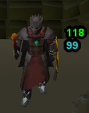
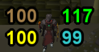
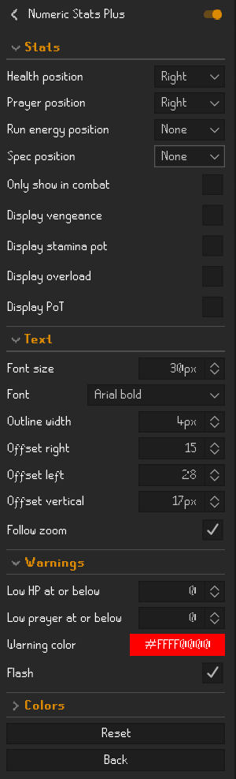

# Numeric Stats Plus

Shows your HP, prayer, run energy and special attack as numbers next to your character, with text you can resize.

Based on [Player Numeric Stats](https://github.com/Cryslacks/player-numeric-stats) by Cryslacks.

## Features

**Stats**
- HP, prayer, run energy and spec, each on the left or right of your character (or hidden)
- HP color fades from your max-health color to your min-health color as you take damage
- Optional icons for vengeance, stamina, overloads and prayer enhance
- Only show in combat: hides the numbers a few seconds after you stop fighting

**Text**
- Font size from 8 to 64 px; potion icons scale with it
- RuneScape bold, regular or small font, or Arial bold
- Black outline (0 to 4 px) for readability on bright floors
- Left, right and vertical offsets
- Follow zoom: the numbers stay in the same spot next to your character as you zoom in and out

**Warnings**
- Pick the HP and prayer levels to warn at
- Warning color, solid or flashing

## Settings

## Changes from Player Numeric Stats
- Adjustable font size, font, outline and vertical offset
- Low HP and prayer warnings
- Only show in combat
- Numbers stay attached to the player when zooming
- The stamina icon shows even when run energy is hidden
- Settings grouped into Stats, Text, Warnings and Colors
- Updated for current RuneLite APIs
